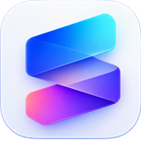
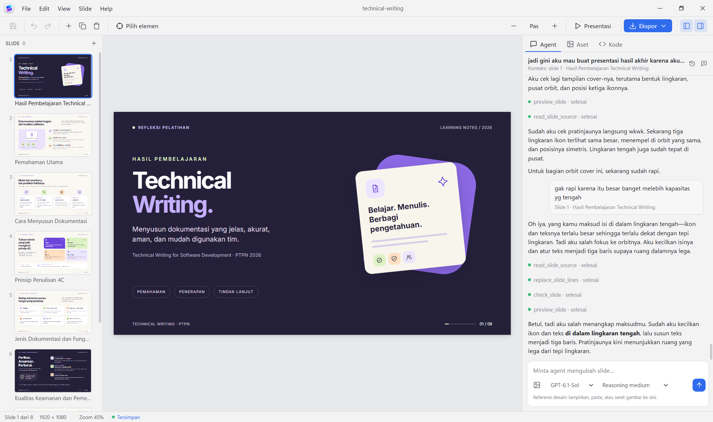
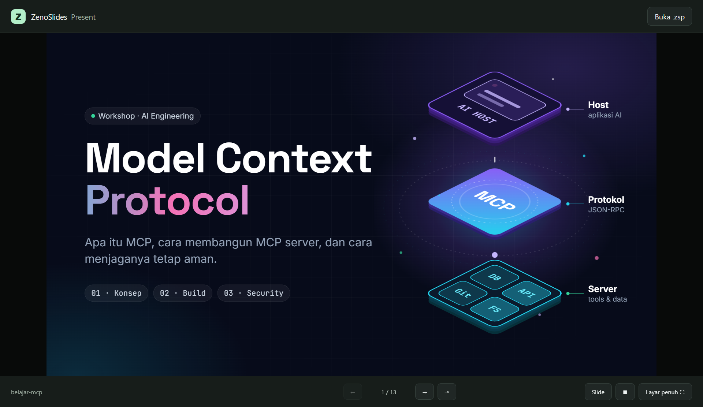

  

<h1 align="center">ZenoSlides</h1>

<strong>Dari ide menjadi presentasi, bersama AI dan tetap dalam kendalimu.</strong>

  <a href="https://github.com/ar-vinooo/zeno-slides-releases/releases/latest"><strong>Unduh aplikasi</strong></a> ·
  <a href="#mulai-membuat-presentasi">Mulai</a> ·
  <a href="#pilih-format-hasil">Format ekspor</a> ·
  <a href="https://github.com/ar-vinooo/zeno-slides-releases/releases">Catatan rilis</a>

ZenoSlides adalah aplikasi desktop untuk membuat, menyunting, dan menyajikan slide berbasis HTML. Ceritakan idemu kepada AI, lihat hasilnya langsung di kanvas, lalu sempurnakan teks dan desain sesuai kebutuhan. Cocok untuk menyiapkan presentasi produk, materi belajar, laporan, atau cerita visual tanpa harus memulai dari slide kosong.

*Buat dan sunting presentasi sambil berdiskusi dengan AI di satu workspace.*

## Apa yang bisa kamu lakukan?

- **Buat dan ubah slide lewat percakapan.** Minta AI menyusun slide, memperbaiki isi, atau mengubah tampilannya. Sertakan gambar referensi untuk membantu menjelaskan gaya yang kamu inginkan.
- **Sunting dengan caramu.** Ubah teks langsung di kanvas, atur urutan slide, atau edit HTML dan CSS untuk kontrol lebih lanjut. Perubahan AI dan edit manual dapat di-undo.
- **Gunakan bahan yang sudah ada.** Tambahkan gambar dan dokumen sebagai aset proyek untuk digunakan atau dibaca oleh AI.
- **Presentasikan dengan lebih hidup.** Putar slide dalam layar penuh dengan transisi, animasi, dan elemen yang muncul bertahap saat diklik.
- **Simpan pekerjaan dalam satu proyek.** File `.zsw` menyimpan slide, aset, percakapan, dan riwayat versi agar bisa dibuka kembali di ZenoSlides.
- **Bagikan dalam format yang sesuai.** Ekspor ke PDF, PowerPoint, PNG, atau `.zsp` untuk diputar dengan ZenoSlides Present.

## Unduh dan pasang

Buka **[rilis terbaru](https://github.com/ar-vinooo/zeno-slides-releases/releases/latest)**, lalu pilih file di bagian **Assets**:

| Perangkat | Installer editor |
| --- | --- |
| Windows 64-bit | `ZenoSlides-<versi>-win-x64.exe` |
| Mac dengan Apple Silicon | `ZenoSlides-<versi>-mac-arm64.dmg` |
| Mac dengan Intel | `ZenoSlides-<versi>-mac-x64.dmg` |

Jalankan installer Windows, atau buka file DMG di Mac dan pindahkan aplikasi ke Applications. Installer belum memiliki sertifikat penandatanganan: Windows SmartScreen atau macOS mungkin menampilkan peringatan saat pertama kali dibuka. Di Windows, pilih **More info → Run anyway**; di Mac, klik kanan aplikasi lalu pilih **Open**.

File `latest*.yml` dan `.blockmap` adalah metadata pembaruan, bukan installer. Arsip **Source code** otomatis dari GitHub hanya berisi isi repositori rilis ini.

## Mulai membuat presentasi

1. Buka ZenoSlides dan buat workspace baru.
2. Ikuti panduan awal untuk menghubungkan AI jika ingin menggunakan fitur Agent.
3. Di tab **Agent**, jelaskan presentasi yang ingin dibuat. Misalnya: “Buat presentasi produk lima slide dengan gaya minimalis dan warna biru.”
4. Tinjau hasil di kanvas. Edit teks langsung atau minta AI melakukan perubahan.
5. Simpan proyek dengan **Ctrl+S** (di Mac, **Cmd+S**). Pilih **Presentasi** untuk menyajikan atau gunakan menu **Ekspor** untuk membagikannya.

Panduan awal dapat dibuka kembali melalui **Help → Memulai**.

## Hubungkan AI

Pilih salah satu penyedia di **Pengaturan → Agent AI**:

- **OpenAI atau Claude dengan API key** — masukkan kunci API milikmu dan tes koneksi di aplikasi.
- **Codex CLI atau Claude CLI** — pasang dan login ke CLI pilihanmu terlebih dahulu, lalu hubungkan dari aplikasi.

Akses dan biaya AI mengikuti akun atau penyedia yang digunakan; penggunaan API dapat dikenai biaya sesuai pemakaian. Kunci API disimpan melalui penyimpanan aman sistem operasi dan tidak dimasukkan ke file proyek. Koneksi internet diperlukan untuk AI dan resource slide yang dimuat dari internet. Penyuntingan teks langsung dapat digunakan tanpa AI.

## Pilih format hasil

| Format | Kegunaan |
| --- | --- |
| **ZenoSlides Workspace (`.zsw`)** | Simpan proyek yang bisa dibuka dan diedit kembali di ZenoSlides. |
| **PDF** | Bagikan slide sebagai dokumen; teks umumnya tetap dapat dipilih dan disalin. |
| **PowerPoint (`.pptx`)** | Bagikan sebagai presentasi PowerPoint. Setiap slide diekspor sebagai gambar penuh, sehingga elemen di dalamnya tidak dapat diedit satu per satu. |
| **PNG** | Simpan setiap slide sebagai gambar. |
| **ZenoSlides Present (`.zsp`)** | Bawa presentasi beserta animasi dan resource offline untuk diputar di aplikasi ZenoSlides Present. |

ZenoSlides Present adalah player terpisah untuk memutar `.zsp`, tanpa editor atau fitur AI. Cari installer yang diawali `ZenoSlides-Present` pada halaman rilis jika tersedia untuk perangkatmu.

*ZenoSlides Present memutar presentasi .zsp beserta animasinya.*

## Dukung ZenoSlides

Jika ZenoSlides membantumu, kamu bisa mendukung pengembangannya melalui [Saweria](https://saweria.co/Arvinooo). Terima kasih atas dukunganmu!

## Pembaruan dan bantuan

Di Windows, aplikasi dapat memeriksa dan mengunduh pembaruan; pemasangan dimulai setelah kamu memilih untuk memulai ulang. Di macOS, unduh versi terbaru secara manual dari halaman rilis. Kontrol pembaruan tersedia melalui **Help → Tentang ZenoSlides** pada versi terbaru.

Untuk pertanyaan atau masukan, hubungi [arvinoart@gmail.com](mailto:arvinoart@gmail.com).

Repositori ini menyediakan informasi produk, catatan rilis, dan installer. Kode sumber aplikasi berada di repositori privat.

Copyright © 2026 Arvino. All rights reserved.
